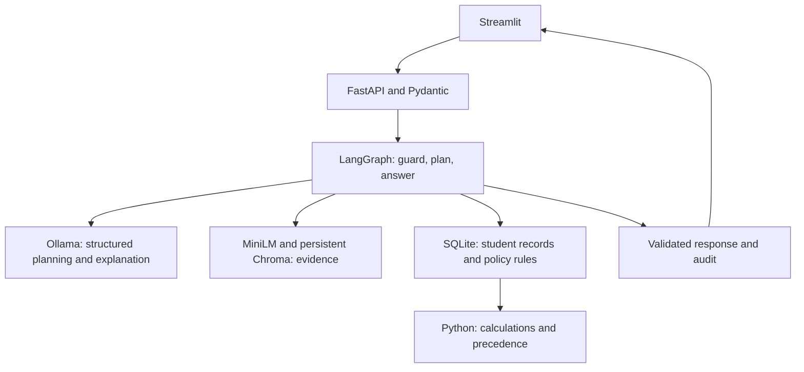

# HCL Hackathon University Assistant MVP

A small university help desk: retrieve policy evidence, calculate student results with Python, show citations, and record an audit. The code follows the University Student Services problem's required stack and is split for a five-person team.

Verification: **18 checks passed**, plus **22/22 development benchmark cases using actual MiniLM retrieval and a mock LLM**. See [verification scope and untested items](docs/VERIFICATION.md). This is not an Ollama accuracy claim.

**MVP status:** development starter, not a finished competition submission. Bundled policies are synthetic fixtures, not official university rules. The deterministic seed is not the required LLM-generated dataset. Use the generator and replace sources before judging. The guide limits synthetic additions to two; the three bundled fixtures are for development only and must not be presented as compliant source documents.

## What works

- Streamlit UI and FastAPI's `/ask`, `/ingest`, `/health`, `/sources`, `/audit/{trace_id}`.
- One bounded LangGraph workflow with an Ollama structured-output adapter.
- MiniLM embeddings and persistent ChromaDB, plus explicit test-only hash embeddings.
- Fixed student/courses/attendance/results/rule-registry SQLite tables and CSV loader.
- Attendance calculation and attendance-condition checks; placement CGPA/backlog checks and a hypothetical backlog-clearance path.
- Supported numeric rule precedence: scope/date, explicit supersession, authority, effective date, unresolved conflicts.
- Live ingestion of supported numeric rules, citation metadata, trace IDs and ownership-filtered audits.
- Validation scripts, tests, 22 development evaluation questions, Docker configuration and explanation notes.

## Run on Windows

Use Python 3.12. The recommended setup works without manually activating the virtual environment, which avoids the PowerShell execution-policy issue that blocks `.venv\Scripts\Activate.ps1` on fresh machines.

### One-command startup (recommended)

From this repository folder, run:

```powershell
py scripts\start_demo.py
```

This script will:

- create `.venv` if it is missing
- install project dependencies only when required
- stop stale demo processes if an earlier run is still holding the ports
- set the demo environment variables
- seed the local development data
- start the FastAPI backend on `http://127.0.0.1:8000`
- start the Streamlit UI on `http://127.0.0.1:8501`
- open the browser automatically on Windows

If you prefer a batch file shorthand, run:

```powershell
start_demo.bat
```

### Manual setup (if you want to run each step yourself)

```powershell
python -m venv .venv
$env:HF_HOME = "$PWD/runtime/models"
$env:ADMIN_TOKEN = "choose-a-local-demo-token"
$env:MOCK_LLM = "true"
.\.venv\Scripts\python.exe -m scripts.seed_demo
.\.venv\Scripts\python.exe -m uvicorn app.main:app --host 127.0.0.1 --port 8000
```

In another terminal, from the same folder:

```powershell
$env:API_URL = "http://127.0.0.1:8000"
.\.venv\Scripts\python.exe -m streamlit run ui.py --browser.gatherUsageStats false --server.address 127.0.0.1 --server.port 8501
```

Open `http://localhost:8501`. API documentation: `http://localhost:8000/docs`.

### Actual local AI mode

Install Ollama from its official website and pull the model. Keep the host Ollama service running.

```powershell
ollama pull qwen2.5:7b-instruct
$env:MOCK_LLM = "false"
$env:OLLAMA_URL = "http://localhost:11434"
$env:OLLAMA_MODEL = "qwen2.5:7b-instruct"
python -m uvicorn app.main:app --port 8000
```

Do not silently use a mock after an Ollama error: the API returns 503 and health reports degradation. Test latency and structured output on your team's laptop. No cloud fallback is implemented in this MVP.

### Docker

```powershell
Copy-Item .env.example .env
# Edit .env and set ADMIN_TOKEN. Ollama remains on the host.
docker compose up --build -d
docker compose exec api python -m scripts.seed_demo
```

API/UI bind to localhost. SQLite, Chroma and model-cache files share the persistent `runtime/` mount. Chroma runs embedded inside the API; SQLite is a file, so separate database containers are unnecessary. For mock mode set `MOCK_LLM=true` in `.env`. Docker requires a real build/run verification on a machine with Docker installed.

## Sample request

```powershell
curl.exe -X POST http://localhost:8000/ask -H "Content-Type: application/json" -H "X-Student-Id: S1001" --data-raw '{"question":"Am I eligible for the CS201 exam?","as_of_date":"2026-10-10"}'
```

The example dataset has 30/40 classes attended for S1001. Before the sample amendment the attendance condition is met at 75%; after it, the 80% condition is not met. These values are read from indexed fixtures and the rule registry, not hard-coded response strings.

## Live ingestion

`POST /ingest` expects multipart `file`, `metadata` JSON containing every Annex B field, and `X-Admin-Token`. The Streamlit ingestion tab also supports this. New versions need new document IDs. Exact repeat uploads are idempotent. See [ingestion details](docs/INGESTION.md).

## Student data

```powershell
python -m scripts.generate_data --attendance-threshold 75 --pass-mark 40
python -m scripts.validate_data --dir runtime/generated --pass-mark 40
python -m scripts.load_students --dir runtime/generated
```

Use thresholds from your actual university documents, not this command's illustrative numbers. Generation uses Ollama, writes its verbatim prompt and model report, and fails on detected violations. Review edge-case coverage and fill in [the data card](docs/DATA_CARD.md). Judges' fixed-schema CSVs can be loaded with the same loader, including reserved IDs. Your own generation must avoid reserved IDs.

## Tests and evaluation

```powershell
python -m pytest -q
python -m scripts.evaluate --output runtime/evaluation.json
# If the environment blocks localhost sockets:
python -m scripts.evaluate --in-process --output runtime/evaluation.json
```

Unit/integration tests explicitly use mock LLM and hash embeddings. The evaluation runner calls the running API and labels its real/mock mode and embedding backend. Its checks are expected response type, expected answer substring and expected document presence. **Document presence is not citation accuracy; this is not a semantic answer-quality benchmark.** Before judging, replace/add official-policy questions, manually grade supported claims and citations, report abstention and tool correctness, and compare retrieval configurations. Never report mock results as LLM accuracy.

## Architecture



See [beginner architecture notes](docs/ARCHITECTURE.md) and [team ownership](docs/TEAM.md).

## Important limits before judging

1. Replace synthetic fixtures with at least three public official university documents. Never use real student personal data.
2. Run real Ollama and generate the required data with preserved prompts, validation results and data card. The development seeder is deliberately labelled.
3. Rule extraction currently recognizes four specific English numeric phrases. Arbitrary circular wording, tables, exceptions and general procedure conflicts need extension. Unsupported rule-bearing changes must not be assumed to update calculators. See INGESTION.md.
4. Exam results check **attendance only**, not every eligibility condition. Placement checks **CGPA and backlogs only**. Responses expose these assumptions. The hypothetical path holds CGPA unchanged and is not a future CGPA prediction.
5. PDF OCR is absent. Text extraction can lose table structure. Check each cited clause manually.
6. `X-Student-Id` is a trusted demo-context header, not production authentication. A real deployment needs authenticated identity, trusted administrative metadata, authorization and secure audit access. Audit owner filtering alone does not authenticate a caller.
7. Injection pattern checks are a limited first layer, not a complete defense. Constrained plans, no arbitrary SQL execution and identity-bound tools provide additional boundaries. LLM explanations can still be wrong; factual passages and tool outputs remain visible separately.
8. Writes and asks share an in-process lock. Run one API worker. Cross-store ingestion compensates failures within a live process but is not a crash-proof distributed transaction.
9. Docker, actual local-model inference and official-document evaluation need verification on the team's machine if unavailable in the development environment.
10. Add the signed original-work declarations and actual contribution statement. Do not attribute AI-generated commits to teammates.

## AI usage disclosure

This starter implementation and its development fixtures were generated with an AI coding assistant. Tests and evaluation methods are disclosed above. Team members must review, adapt and explain the code they submit. No teammate contributions or real university policy claims are fabricated.
